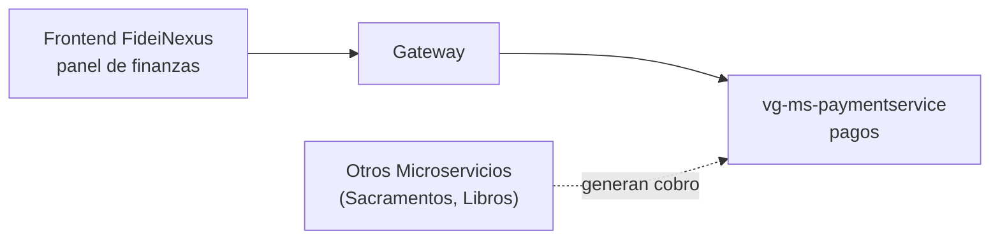

# vg-ms-paymentservice

**FideiNexus** es el sistema web de las parroquias. El módulo de **Finanzas y Pagos** centraliza y muestra qué cobros se realizan por cada trámite o sacramento. Lo forman microservicios que trabajan juntos:



## 1. Qué hace

Guarda los **pagos** de la parroquia: cada cobro por misa, catequesis, certificado o venta de libros que se registra en el sistema. Cada pago es iniciado por otro microservicio y luego confirmado por el área de finanzas.

### Qué datos maneja

| Dato | Ejemplo |
| :--- | :--- |
| **Monto** | `80.00` |
| **Estado** | `PENDING`, `COMPLETED`, `CANCELLED` |
| **Método de pago** | `YAPE`, `EFECTIVO`, `TRANSFERENCIA` |
| **Referencia/Voucher** | `OPER-987654321` |

## 2. API
Base URL local: `http://localhost:8086/payments`
Todos los endpoints requieren un JWT válido. Los roles se leen desde `realm_access.roles` y se convierten a authorities `ROLE_*`.

| Método | Ruta | Roles |
| :--- | :--- | :--- |
| `POST` | `/` | `MS_INTERNOS` |
| `PATCH` | `/{id}/complete` | `ADMIN`, `FINANCE` |
| `PATCH` | `/{id}/cancel` | `ADMIN`, `FINANCE` |
| `GET` | `/` | `ADMIN`, `FINANCE` |
| `GET` | `/{id}` | `ADMIN`, `FINANCE` |
| `GET` | `/tenant/{tenantId}` | `ADMIN`, `FINANCE` |

### Cuerpos principales:
**Iniciar un pago (Driving desde otro MS):**
```json
{
  "tenant_id": 1,
  "persona_id": 105,
  "request_id": 302,
  "monto": 80.00
}
```

**Completar un pago (Desde Finanzas):**
```json
{
  "metodo_pago": "YAPE",
  "reference": "OPER-987654321",
  "confirmed_by": 10
}
```

## 3. Configuración híbrida
La aplicación importa opcionalmente `.env` y mantiene los alias históricos para no romper los entornos existentes:
* Se prioriza `SPRING_R2DBC_URL`, luego `R2DBC_URL`.
* Se priorizan `SPRING_R2DBC_USERNAME` y `SPRING_R2DBC_PASSWORD`.
* `SERVER_PORT` tiene respaldo en `PORT`.
* Las credenciales reales deben estar únicamente en variables del entorno o en un `.env` local, nunca en el repositorio.

Copia `.env.example` como `.env` y reemplaza los valores ficticios antes de ejecutar.

## 4. Base de datos
La tabla `payments` y los índices consumidos por la entidad R2DBC deben existir en PostgreSQL/NeonDB. 
El script no se ejecuta automáticamente por defecto: `SPRING_SQL_INIT_MODE=never`. Aplícalo manualmente en la base que corresponda al microservicio. 

## 5. Cómo levantarlo

**Ejecución local**
```bash
cp .env.example .env
mvn clean compile
mvn spring-boot:run
```
Documentación OpenAPI:
* `/swagger-ui.html`
* `/api-docs`

**Docker**
```bash
docker build -t vg-ms-paymentservice .
docker run --rm --env-file .env -p 8086:8086 vg-ms-paymentservice
```
La imagen compila con Maven, ejecuta con JRE 17 y usuario no root. El healthcheck consulta `/actuator/health`.

## 6. CI y estándares
Se conserva `.gitlab-ci.yml` con el job `standards-check`, ejecutado en la rama `develop`, con artefactos por 30 días y `allow_failure: true`.
El checker verifica paquete base, separación de capas (Arquitectura Hexagonal), DTOs, endpoints, configuración de variables, Dockerfile y documentación.
